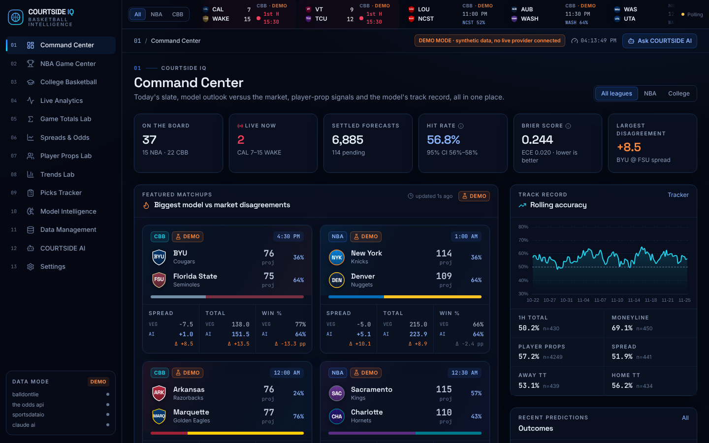
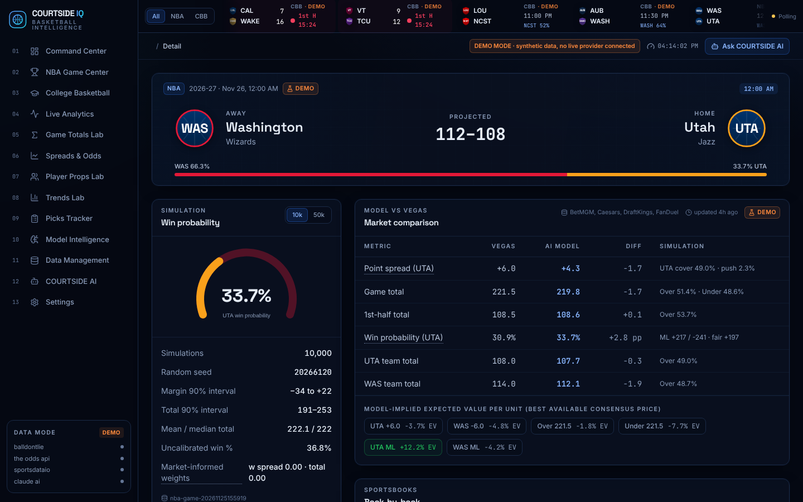
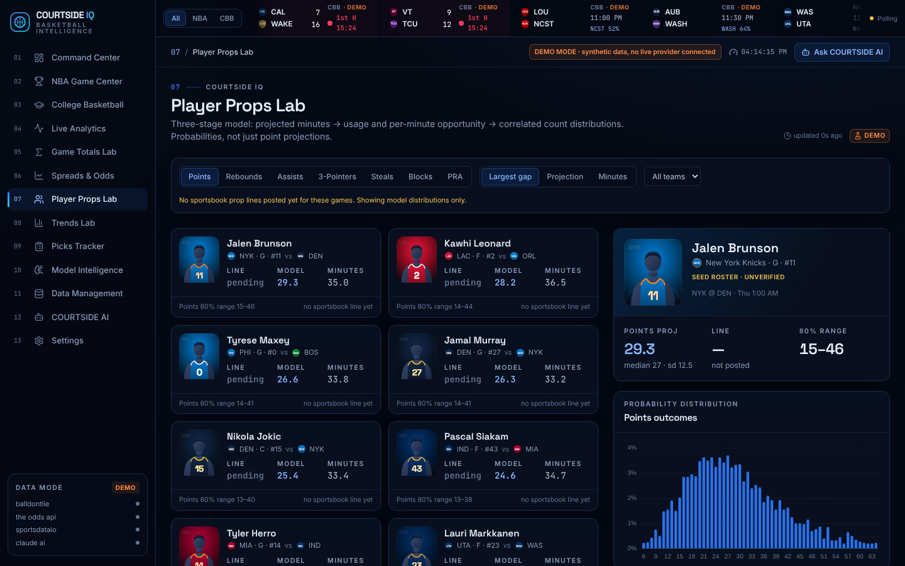
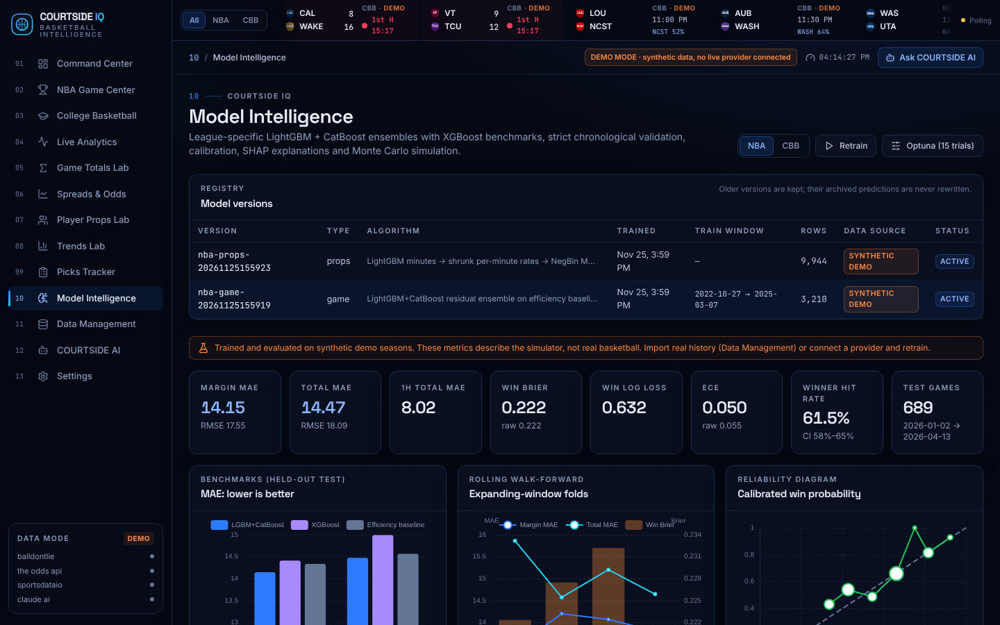
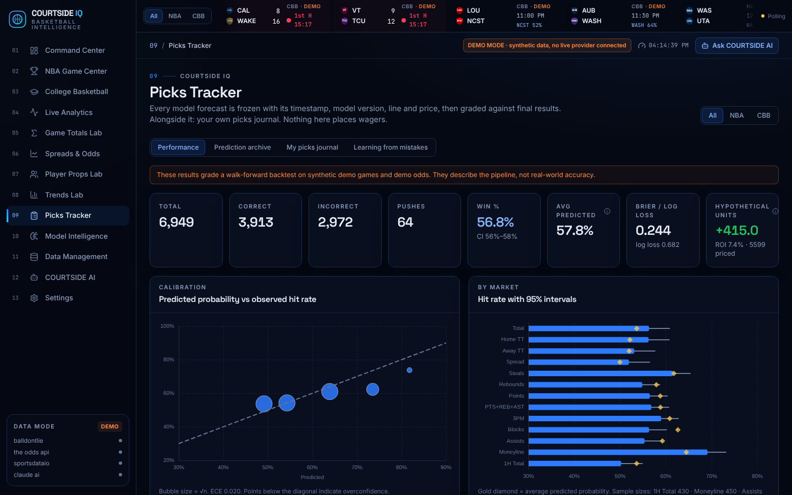
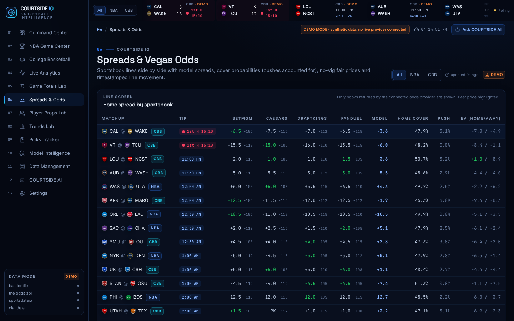
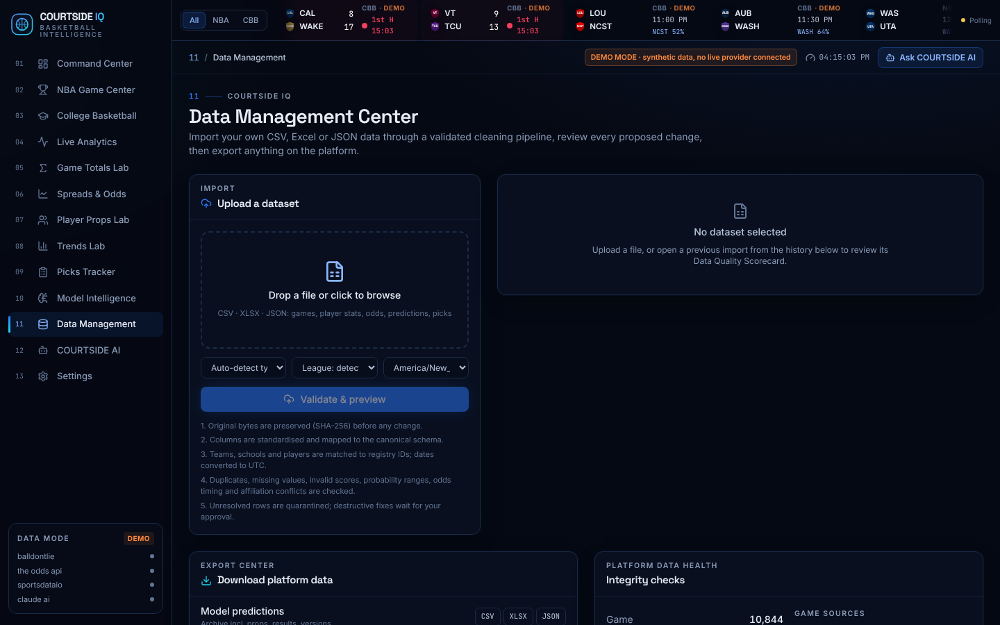
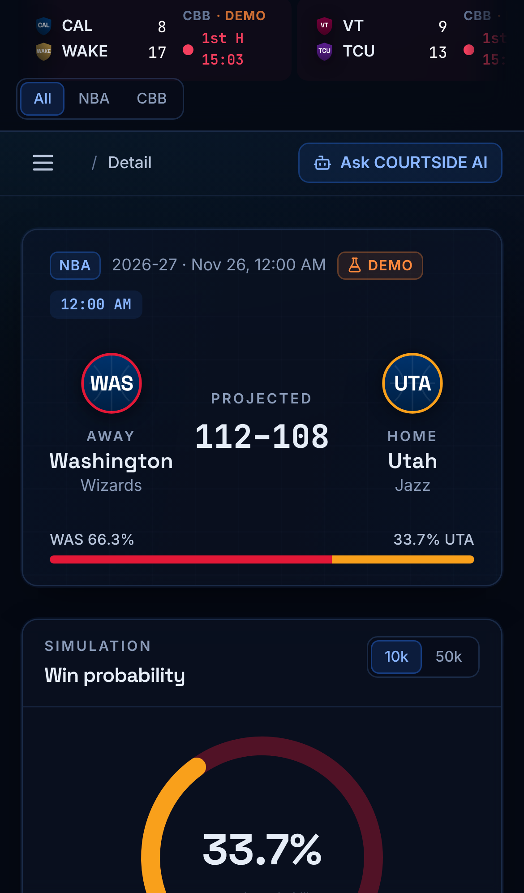

# COURTSIDE IQ

Basketball analytics platform for the NBA and NCAA men's basketball. It combines a live scoreboard, league-specific machine-learning projections, Monte Carlo simulation, sportsbook market comparison, player prop distributions, a trends lab, a permanent prediction archive with automated grading, a data import and cleaning pipeline, and an AI research assistant that answers questions from the platform's own records.



> COURTSIDE IQ is research and analysis software. Forecasts are probability estimates and are not betting or financial advice. The application never places wagers.

## Contents

- [Features](#features)
- [Screenshots](#screenshots)
- [Architecture](#architecture)
- [Getting started](#getting-started)
- [Configuration](#configuration)
- [Data](#data)
- [Modeling](#modeling)
- [Prediction archive and grading](#prediction-archive-and-grading)
- [Data management](#data-management)
- [COURTSIDE AI](#courtside-ai)
- [Testing](#testing)
- [Deployment](#deployment)
- [Limitations](#limitations)

## Features

| Area | Highlights |
|---|---|
| Command Center | Live ticker (Server-Sent Events), featured matchups, model vs market outlook, prop signals, rolling accuracy |
| NBA and College centers | Slates, schedules, efficiency standings, team directories by conference, rosters |
| Live Analytics | Game state, pace vs projection, in-game win probability and projected totals |
| Game Totals Lab | Estimated possessions, simulated score distributions, first-half and team totals |
| Spreads and Odds | Book-by-book line screen, cover and push probabilities, alternate-line ladder, line movement, no-vig calculator |
| Player Props Lab | Minutes model, per-stat probability distributions, correlation between stats, prop history |
| Trends Lab | Team and player rolling windows with sample sizes, splits, ATS and over/under history, heatmaps, correlation matrix |
| Picks Tracker | Permanent forecast archive, calibration, accuracy by market/team/player/conference, closing line value, personal picks journal, error diagnostics |
| Model Intelligence | Version registry and comparison, held-out metrics, benchmarks, walk-forward and season-by-season backtests, SHAP explanations, Optuna tuning, simulation explorer |
| Data Management | CSV/XLSX/JSON import with validation, quarantine and approval; formatted exports |
| COURTSIDE AI | Claude-based assistant with read-only database tools, semantic retrieval and record citations |

## Screenshots

| Game detail | Player props |
|---|---|
|  |  |
| **Model Intelligence** | **Picks Tracker** |
|  |  |
| **Spreads and odds** | **Data Management** |
|  |  |



## Architecture

```
courtside-iq/
├── backend/                 FastAPI service (Python 3.12+)
│   ├── app/
│   │   ├── models.py        SQLAlchemy schema (26 tables)
│   │   ├── registry/        NBA franchises, NCAA schools and conferences, NBA seed roster
│   │   ├── providers/       BALLDONTLIE and The Odds API clients, rate limiting, retries, sync
│   │   ├── ml/              Point-in-time features, game model, props model, simulator, metrics
│   │   ├── services/        Modeling, market math, settlement, performance, trends, diagnostics
│   │   ├── data_mgmt/       Import pipeline, exports, dataset snapshots
│   │   ├── ai/              Retrieval (pgvector), read-only tools, Claude tool-use loop
│   │   ├── api/routes.py    REST API and SSE ticker
│   │   ├── scheduler.py     Data refresh, forecast archiving, settlement
│   │   └── cli.py           Operations CLI
│   ├── alembic/             Database migrations
│   ├── data/demo_snapshot/  Committed dataset (gzipped CSV + manifest)
│   └── tests/               Backend test suite
├── frontend/                Next.js 15, TypeScript, Tailwind, Radix UI, Framer Motion, ECharts, TanStack
├── docs/                    Deployment guide, dataset reference, screenshots
└── docker-compose.yml       PostgreSQL + pgvector, Redis, API, worker, web
```

| Layer | Technology |
|---|---|
| API | FastAPI, SQLAlchemy 2, Alembic, Pydantic |
| Storage | PostgreSQL 16 with pgvector (SQLite supported for development), Redis cache |
| Modeling | LightGBM, CatBoost, XGBoost (benchmark), scikit-learn, SHAP, Optuna, NumPy, pandas, SciPy |
| AI | Anthropic Claude API, pgvector retrieval |
| Frontend | Next.js, React 19, Tailwind CSS, Radix UI, Framer Motion, Apache ECharts, Recharts, TanStack Query and Table |
| Delivery | Docker, GitHub Actions |

## Getting started

### Docker

```bash
cd courtside-iq
cp .env.example .env
docker compose up --build
```

- Web: http://localhost:3000
- API documentation: http://localhost:8000/docs

On first start the API loads the committed dataset, trains both leagues' models and builds the prediction archive. This takes about two minutes.

### Local development

Requirements: Python 3.12+, Node.js 22.

```bash
make install        # Python virtualenv + npm dependencies
make api            # http://localhost:8000 (SQLite by default)
make web            # http://localhost:3000 (second terminal)
```

Run `make help` for all targets.

## Configuration

Settings are read from environment variables (see `.env.example`). API keys are used only by the server and are never sent to the browser.

| Variable | Purpose |
|---|---|
| `DATABASE_URL` | SQLAlchemy URL. Default `sqlite:///./courtside.db` |
| `REDIS_URL` | Optional provider response cache |
| `BALLDONTLIE_API_KEY` | Games, live scores, box scores, rosters, injuries |
| `ODDS_API_KEY` | Sportsbook odds (The Odds API v4) |
| `SPORTSDATAIO_API_KEY` | Health checks only; endpoint mapping depends on the subscription |
| `ANTHROPIC_API_KEY`, `ANTHROPIC_MODEL`, `AI_EFFORT` | COURTSIDE AI |
| `LICENSED_LOGO_BASE_URL` | Base URL of a licensed logo CDN (`{slug}.svg`) |
| `LIVE_POLL_SECONDS`, `ODDS_POLL_SECONDS` | Refresh cadence |
| `MONTE_CARLO_SIMS`, `RANDOM_SEED` | Simulation size and reproducibility |
| `USE_DEMO_SNAPSHOT` | Load the committed dataset in demo mode (default `true`) |
| `ADMIN_TOKEN` | Protects retrain, tune, refresh and asset registration endpoints |
| `MLFLOW_TRACKING_URI` | Optional experiment tracking |

### Demo mode and live mode

Without provider keys the platform runs in demo mode. The interface shows a demo banner and `DEMO` labels, and every demo row carries `is_demo = true` in the database and in exports.

With keys configured, the scheduler:

- syncs games and live scores
- captures timestamped odds snapshots
- pulls box scores for finished NBA games
- refreshes the injury report every 30 minutes and records each upcoming game's injury impact
- pulls first-half totals, team totals, alternate lines and player props for games starting within 12 hours
- freezes pre-game forecasts and grades them after the final

## Data

The repository includes the complete demo dataset in `backend/data/demo_snapshot/`, as gzipped CSV files with a manifest of row counts and SHA-256 checksums:

| Table | Rows |
|---|---|
| Games (four seasons per league plus the 2026-27 season) | 10,844 |
| Team box scores | 17,778 |
| Player game logs | 13,085 |
| Odds snapshots (4 sportsbooks) | 146,190 |
| Player prop lines | 9,800 |
| Archived predictions (export only) | 7,714 |

The demo dataset is produced by the project's league simulator (`backend/app/ml/synthetic.py`). It is synthetic: games, statistics and odds are not real. The team, school and conference registries are real, and the NBA seed roster lists 48 real players with their 2025-26 teams, flagged as unverified until a provider roster sync confirms them. No college players are included because college rosters change every season.

`docs/DATA.md` documents the files and columns. To regenerate or reload the data:

```bash
cd backend
python -m app.cli export-snapshot      # database -> backend/data/demo_snapshot
python -m app.cli load-snapshot        # snapshot -> empty database
```

Real historical data can be imported through Data Management, after which the models are retrained on it (`python -m app.cli train --league NBA`).

## Modeling

### Features

Features are computed strictly in chronological order: each game uses only games completed before it. A test asserts that changing a later result never changes an earlier game's features.

- Opponent-adjusted offensive and defensive efficiency
- Pace and four factors on both ends (eFG%, turnover rate, offensive rebound rate, free throw rate)
- Recent form (last 5 and 10 games), home and road splits, rest days and back-to-backs, travel distance
- Pre-game injury impact, lineup changes, strength of schedule
- College only: conference strength, non-conference performance, neutral sites, roster continuity, and empirical-Bayes shrinkage toward a conference prior for small samples

Games with a final score but no box score (score-only imports, feeds without box scores) still update efficiency, using points over expected possessions, and count as training data.

### Game model

1. A structural baseline: expected pace multiplied by opponent-adjusted points per possession.
2. LightGBM and CatBoost regressors learn the residual on top of the baseline for margin, total and first-half total; the projection is their average. XGBoost is trained as a benchmark.
3. Each game is simulated 10,000 times (configurable) from a bivariate normal distribution of margin and total, with spread and correlation estimated on an out-of-sample calibration fold. Scores are rounded to integers, ties go to simulated overtime, and seeds are fixed per game.
4. Win probability is isotonic-calibrated. Cover, push and over/under probabilities come from the simulated outcomes, so any alternate line can be priced.

Spread and total probabilities use a market-informed mean: `w * model + (1 - w) * market line`. The weight `w` is fit on the calibration fold. The pure model projection is still the line shown against the sportsbook.

### Validation

- Chronological split: 70% train, 15% calibration, 15% test
- Four expanding-window walk-forward folds
- A season-by-season backtest: train on every earlier season, test on the next
- Metrics: MAE, RMSE, Brier score, log loss, expected calibration error, hit rate with Wilson intervals
- Hyperparameter search with Optuna on a chronological validation fold

### Results on the demo dataset

Held-out test fold:

| League | Games | Margin MAE (ensemble / XGBoost / baseline) | Total MAE (ensemble / XGBoost / baseline) | Win Brier |
|---|---|---|---|---|
| NBA | 689 | 14.15 / 14.41 / 14.34 | 14.47 / 14.99 / 14.57 | 0.222 |
| CBB | 485 | 11.09 / 11.33 / 11.24 | 11.88 / 12.24 / 11.94 | 0.223 |

The simulated sportsbook market is efficient, so the fitted market weight for NBA spreads and totals is close to zero: the model adds little information beyond the closing line on this dataset. These figures describe the simulator; performance on real games has to be measured after importing real history.

### Player props

1. Minutes: LightGBM on recent and season minutes, rest, blowout risk (absolute projected spread), teammate injuries and sample size.
2. Opportunity: per-minute production rates, shrunk toward the season rate and adjusted for pace and opponent defense.
3. Outcomes: Negative Binomial simulations that share a game-flow multiplier, so points, assists and threes are positively correlated. PRA is summed per simulation.

When a sportsbook line exists, the mean is anchored to it with a per-stat weight. The weight is fit on the oldest 70% of settled prop forecasts and checked on the newest 30%. It is adopted only when it beats the default weight of 0.5 on that holdout, and it applies to new forecasts only.

## Prediction archive and grading

- **Append-only archive.** `predictions` stores each forecast's timestamp, data timestamp, model version, market, selection, probability, line, price and sportsbook. Retraining never modifies existing rows.
- **Settlement rules.** Settlement adds a `settlements` row with the rule applied:
  - moneyline includes overtime
  - a result landing exactly on the line is a push
  - first-half markets use first-half scores
  - a player prop on a player who did not play is void
- **What gets scored.** Performance uses the latest forecast made before tip-off for each game, market and player.
- **Closing line value.** Each spread, total and moneyline forecast is compared with the consensus of each sportsbook's last pre-game snapshot.
- **Diagnostics.** Errors are aggregated (pace and total bias, margin bias, calibration by market, minutes errors on props, errors by conference) with sample sizes and two-standard-error tests. Models are never changed automatically from diagnostics.

## Data management

Uploads (CSV, XLSX or JSON) go through these steps:

1. The original file is stored with its SHA-256 checksum.
2. Columns are standardized and mapped to the canonical schema.
3. Types are coerced and timestamps converted to UTC.
4. Teams, schools and players are matched to registry IDs.
5. Rows are checked for duplicates, missing values, invalid scores, probability ranges, odds formats, late odds timestamps, outlying player statistics and player-team affiliation conflicts.
6. Unresolved rows are quarantined. Destructive corrections wait for approval, and every decision is logged.

A data quality scorecard summarizes each import. Exports are available in CSV, XLSX (formatted, with a README sheet) and JSON.

## COURTSIDE AI

The assistant runs a tool-use loop against the Anthropic Messages API (`claude-opus-5-5` by default). It has ten read-only tools covering:

- projections with SHAP drivers
- odds movement
- efficiency tables
- player trends
- performance breakdowns
- market disagreements
- diagnostics
- recent results
- semantic document search

Retrieval covers methodology documents, model cards, daily performance digests, game recaps, diagnostics and league leaders. These are rebuilt from database records after each settlement.

Every answer includes citations to the records used. The system prompt does not allow figures that no tool returned. Set `ANTHROPIC_API_KEY` to enable the assistant.

## Testing

```bash
make test                     # backend (SQLite) + frontend
make test-postgres            # backend against PostgreSQL + pgvector (TEST_DATABASE_URL)
```

The backend suite covers:

- odds math and settlement rules
- feature leakage
- training, benchmarks and simulation reproducibility
- the prediction archive and the props model
- provider sync (with recorded payloads), live-mode enrichment, alternate lines and version comparison
- the import pipeline, exports and dataset snapshots
- the AI tool loop (with a mocked client)
- the API

GitHub Actions runs the backend on SQLite and PostgreSQL, the frontend type check, tests and production build, and both Docker image builds.

## Deployment

See [docs/DEPLOYMENT.md](docs/DEPLOYMENT.md).

## Limitations

- Live scores, odds, injuries and prop lines require BALLDONTLIE and The Odds API subscriptions. NCAA live data requires a BALLDONTLIE plan with NCAAB access. Provider field mappings are covered by tests on representative payloads and should be confirmed against live responses when keys are added.
- Official NBA and NCAA logos and player likenesses are not bundled because they require licenses. Teams display original crests in their colors, and players display a uniform-and-number illustration. Licensed assets can be registered in Settings or served from `LICENSED_LOGO_BASE_URL`.
- Shot charts require shot coordinates, which the integrated feeds do not provide on standard plans.
- Authentication is limited to an admin token for mutating endpoints. Multi-user deployments should run behind an identity-aware proxy.
